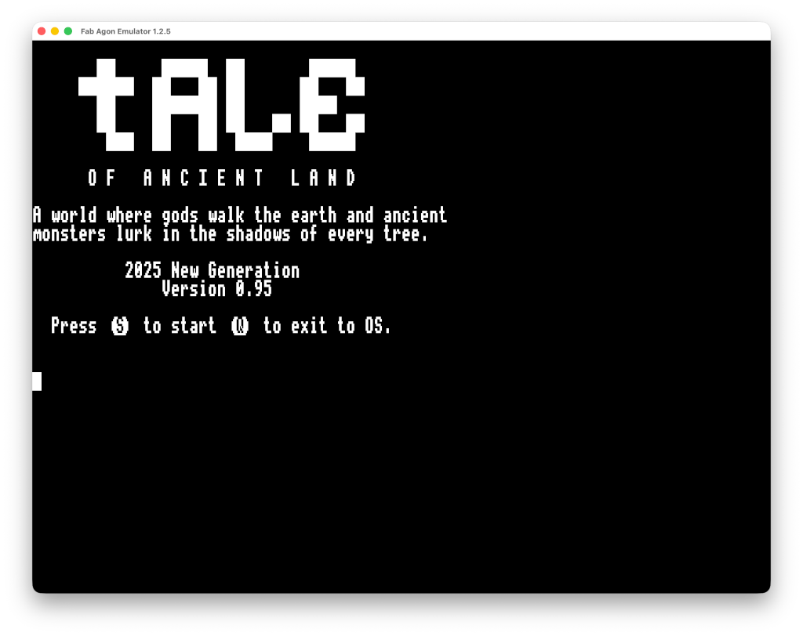
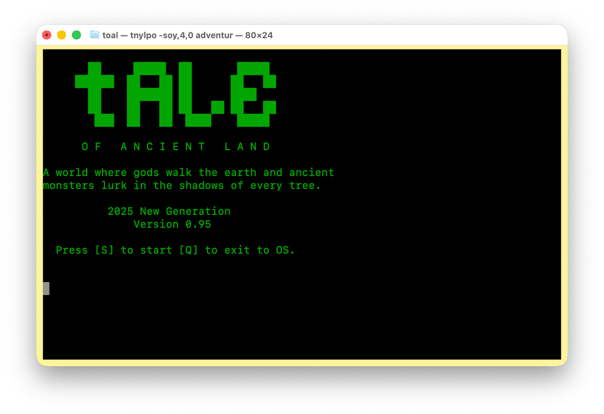
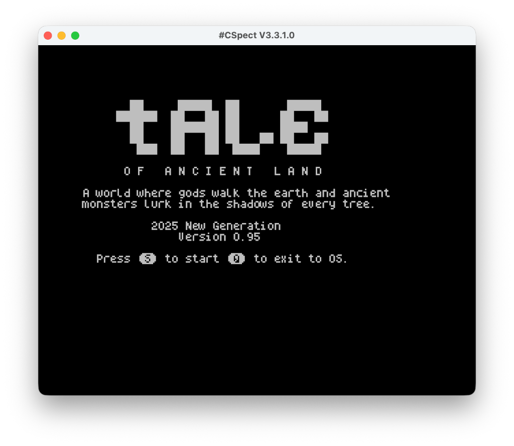

# Tale of Ancient Land

A text-based RPG written in Turbo Pascal 3.0 for various retro systems. Designed to be runnable primarily on CP/M 2.2 (and CP/M+ aka CP/M 3.0). This fork adapts the code to the [PASTA/80](https://github.com/pleumann/pasta80) compiler and provides binaries for some of its supported systems (currently [Agon](https://agonplatform.github.io/agon-docs), [CP/M](https://en.wikipedia.org/wiki/CP/M), and the [ZX Spectrum Next](https://www.specnext.com)).

<table>
  <tr>
    <th align="center">Agon</th>
    <th align="center">CP/M</th>
    <th align="center">Next</th>
  </tr>
  <tr>
    <td align="center" valign="top"></td>
    <td align="center" valign="top"></td>
    <td align="center" valign="top"></td>
  </tr>
</table>

The latest binaries are in the folder `bin` and also on the [release page](https://github.com/pleumann/adventure/releases).

The port itself was rather straightforward. Agon and CP/M worked basically out-of-the-box. The Next, having less resident memory (due to ROM and video RAM), needed overlays. This required rewiring the code a bit. The main command dispatcher, in particular, was much too large. So I enclosed the handler code for each location into its own `overlay procedure`, keeping the changes to existing code as minimal as possible. For Agon and Next, I dropped the terminal configuration system, since it is not needed. I also used two User-Defined Graphics (UDGs) to make keys you can press stand out a bit more than they do with the square brackets.

Assuming you have `pasta80` installed and in your `PATH`, all it takes to build the binaries is:

```
$ ./build.sh        # on Mac or Linux
$ build.bat         # on a Windows PC
```

Binaries have been tested with these emulators:

* [Fab Agon Emulator](https://github.com/tomm/fab-agon-emulator) for Agon
  * Unzip on the SD card.
  * Run `adventure.bin`.
* [tnylpo](https://gitlab.com/gbrein/tnylpo) for CP/M.
  * Unzip into a directory of your choice.
  * Rename all files to lower-case because tnylpo needs this.
  * Run `tnylpo -s advconf` to configure the terminal.
  * Run `tnylpo -s adventur` to play the game.
* [CSpect](https://mdf200.itch.io/cspect) for the Next
  * Unzip somewhere on the SD card.
  * Select `adventure.run` in the browser.

The [original game](https://github.com/delysio/adventure) was written by [Delysio](https://github.com/delysio) und released under [CC-BY-SA-4.0](LICENSE). The rest of the document contains his original README.md unchanged, but does not necessarily apply to this port.

## Systems tested

- Windows terminal (ANSI)
- Commodore 128 (ADM31)
- Amstrad CPC 6128
- Elwro 800 Junior
- BOSMAN-8
- Indus GT (disk drive for Atari 8-bit computers)
- Atari 1090XL
- SVI 738 (MSX)
- ZX Spectrum 128+3
- FDD 3000 (disk drive for ZX Spectrum / Timex computers)

## How do I transfer a compiled file to a floppy disk image?

### Amstrad CPC

Use a pre-made disk image or transfer files using [CPCDiskXP](http://www.cpcmania.com/cpcdiskxp/cpcdiskxp.htm)

### Elwro 800 Junior

Use a pre-made disk image or transfer files using ElwroDiskManager

### ZX Spectrum +3

Use a pre-made disk image or transfer files using [CPCDiskXP](http://www.cpcmania.com/cpcdiskxp/cpcdiskxp.htm)

### ZX Spectrum 48 / Timex 2048 with FDD 3000 

Use a pre-made disk image or transfer files using [cpmtools](https://github.com/lipro-cpm4l/cpmtools) package

### Commodore 128

Use a pre-made disk image or transfer files using [RDCBM](https://www.retroisle.com/commodore/c64128/Articles/c128_cpm.php)

### Spectravideo SVI 738 (MSX)

Use a pre-made disk image or transfer files using [cpmtools](https://github.com/lipro-cpm4l/cpmtools) package

### BOSMAN 8

Use a pre-made disk image or transfer files using [cpmtools](https://github.com/lipro-cpm4l/cpmtools) package

### Atari 1090XL

Use a pre-made disk image or transfer files using DOS2COPY included in CP/M bootdisk

### Atari XL/XE with Indus GT / LDW Super 2000 / California Access 2001

Use a pre-made disk image or transfer files using File Explorer in [Altirra](https://www.virtualdub.org/altirra.html)

Note: Altirra up to Altirra version 4.40-test8 has broken CP/M filesystem support. Use Altirra version 4.40-test9 or higher.

### Other

Most systems can also be handled using the [cpmtools](https://github.com/lipro-cpm4l/cpmtools) package

Programming and story: dely / New Generation + Blowjobb.

Testing: krap, Peri Noid, Bocianu, dox

Additional assistance: drac030 / DLT, Steev

***

2025, Radom, Poland.